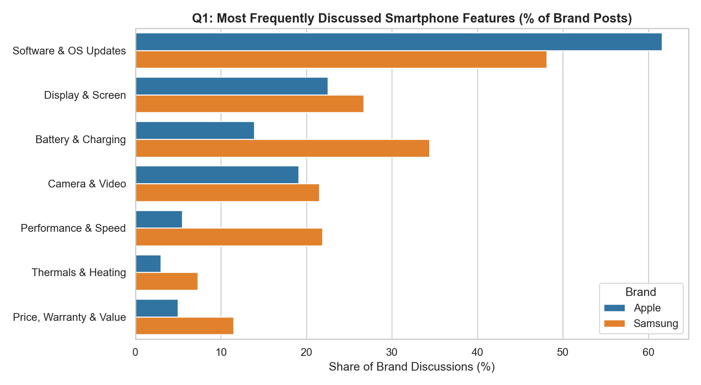
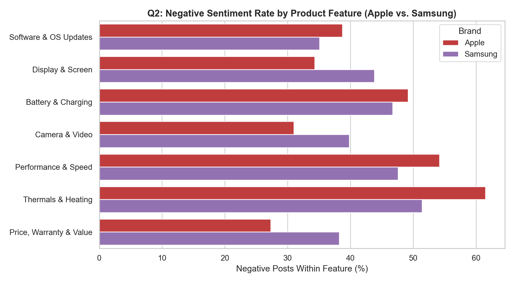
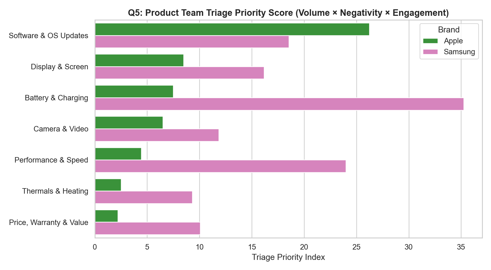

# SocialPulse: Consumer Pain-Point Intelligence from Social Media
**Discover What Consumers Love, Hate, and Want Improved**

Rather than a generic macro sentiment-analysis notebook, **SocialPulse** is an end-to-end consumer intelligence pipeline that collects real-world Reddit product discussions, deduplicates cross-subreddit posts, tags multi-label smartphone features, applies a domain-tuned sentiment lexicon, extracts recurring complaint n-grams via TF-IDF, and computes an engineering **Triage Priority Score** across **Apple** and **Samsung**.

---

## 1. Key Insight: Why Macro Sentiment Fails Product Teams

When evaluating **983 raw Reddit posts** (510 Samsung, 473 Apple) across `r/iphone`, `r/ios`, `r/apple`, `r/samsung`, `r/samsunggalaxy`, and `r/GalaxyS24`, macro brand-level sentiment looks nearly identical:

| Brand | Negative (%) | Neutral (%) | Positive (%) |
| :--- | :---: | :---: | :---: |
| **Apple** | 37.7% | 15.2% | 47.0% |
| **Samsung** | 39.0% | 14.0% | 47.1% |

**What SocialPulse Uncovers via Aspect-Level Triage:**
Once discussions are decomposed into 7 hardware/software aspects and weighted by **Mention Share x Negative Rate x Community Engagement**, the two brands reveal completely different engineering priorities:

| Brand | Rank | Product Aspect | Mentions | Negative Rate (%) | Triage Priority Score |
| :--- | :---: | :--- | :---: | :---: | :---: |
| **Apple** | **#1** | **Software & OS Updates** | 271 | 38.7% | **26.22** |
| **Apple** | **#2** | **Display & Screen** | 99 | 34.3% | **8.49** |
| **Apple** | **#3** | **Battery & Charging** | 61 | **49.2%** | **7.49** |
| **Samsung** | **#1** | **Battery & Charging** | 165 | 46.7% | **35.25** |
| **Samsung** | **#2** | **Performance & Speed** | 105 | **47.6%** | **23.99** |
| **Samsung** | **#3** | **Software & OS Updates** | 231 | 35.1% | **18.54** |

- **Actionable Takeaway for Apple:** Software/iOS stability dominates total pain-point volume (`271` mentions, triage score `26.22`), while **Battery & Charging** exhibits the highest severity when mentioned (`49.2%` negative).
- **Actionable Takeaway for Samsung:** Even though Software/One UI has more total mentions (`231`), **Battery & Charging** (`35.25` triage score) and **Performance & Speed** (`47.6%` negative, `23.99` triage score) rank as the #1 and #2 urgent engineering priorities due to higher negative intensity and user engagement.
- **Explicit Feature & Improvement Requests:** Identified **24 concrete user improvement requests** using conversational intent patterns.

---

## 2. Visual Findings

### Q1: Feature Share of Voice (Apple vs. Samsung)


### Q2: Negative Sentiment Rate by Feature


### Q5: Product Team Triage Priority Matrix


*(See [`reports/findings.md`](reports/findings.md) for the full TF-IDF bigram/trigram complaint tables and complete aspect breakdown.)*

---

## 3. Repository Structure

```text
SocialPulse/
|-- README.md
|-- requirements.txt
|-- .gitignore
|-- notebooks/
|   |-- 01_data_collection.ipynb
|   |-- 02_data_cleaning_eda.ipynb
|   +-- 03_sentiment_and_topics.ipynb
|-- src/
|   |-- collect_data.py          # Reddit data ingestion pipeline
|   |-- preprocess.py            # Deduplication, dual text cleaning & multi-label aspect tagger
|   |-- analyze_pain_points.py   # Domain-tuned VADER, TF-IDF n-grams & triage scoring
|   +-- finalize_portfolio.py    # Notebook & documentation generator
+-- reports/
    |-- findings.md              # Automated executive report with full tables
    +-- figures/                 # High-DPI visualizations
```

---

## 4. How to Reproduce the Pipeline

```bash
pip install -r requirements.txt
python src/collect_data.py
python src/preprocess.py
python src/analyze_pain_points.py
```

---

## 5. Methodological Rigor & Limitations
1. **Domain-Specific Sentiment Calibration:** Off-the-shelf VADER scores technical hardware complaints (*battery drain*, *shutter lag*, *thermal throttling*) as neutral. We injected a 35-term smartphone defect lexicon and validated the shift against baseline VADER.
2. **Observational & Self-Selection Bias:** Reddit communities (`r/iphone`, `r/samsung`) act as peer-support forums. High negative rates reflect *troubleshooting share of voice* rather than retail hardware defect rates across all consumers.
3. **Data Ethics & Redistribution Compliance:** Raw user text (`data/raw/` and `data/processed/`) is excluded from version control via `.gitignore` in accordance with platform redistribution policies; the full pipeline and aggregated intelligence reports are 100% reproducible.